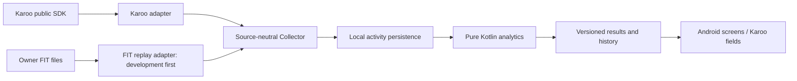

# System context

Status: proposed, 2026-11-10. Owner-selected boundaries are fixed in [ADR 0001](adr/0001-source-neutral-core.md).

Single-user, on-device modular monolith. No network backend. Build-time GitHub Packages authentication is separate from runtime offline behavior. FIT import UI is future scope; fixture decoding enters validation early.

External systems are the Karoo host, paired sensors through Karoo, and user-provided files. OxyWatt does not pair or drive sensors directly in the initial architecture, synchronize Hammerhead accounts, or depend on access to the host's private ride files. Chart/history belongs to the application screen; a custom ride field is only a read-only projection of persisted state.

Scientific results may be unavailable while observed power analytics works correctly. Success of one path does not imply validation of the other.
